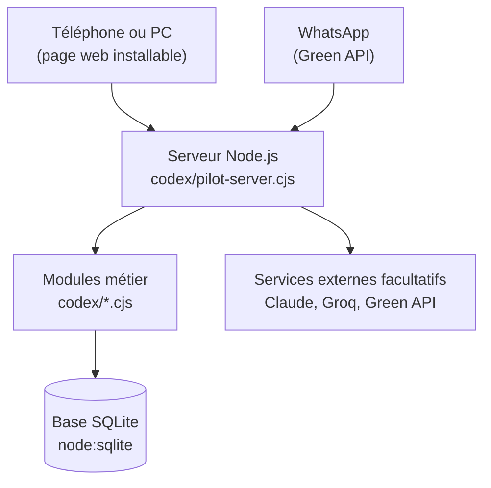

# Fibre Guardian

[](https://github.com/Bryan-Taffo-Stephen-Yves/fibre-guardian-moov/actions/workflows/tests.yml)

Application de self-care et de diagnostic de la fibre pour **Moov Africa Côte d'Ivoire**, présentée au concours MOOV APPLICATION 2026 (thème 3 « Fibre Guardian »).

Quand la fibre d'un client ne marche plus, Guardian trouve la cause, prévient le client avant qu'il appelle, ouvre **un seul dossier** pour toute la zone, fait valider un plan par un responsable Moov, envoie le bon technicien et confirme le retour du service.

- **En ligne :** https://fibre-guardian-moov.onrender.com (hébergement gratuit : la première ouverture peut prendre une minute).
- **Version active :** tout le code de l'application est dans [`codex/`](codex/).

## Qui l'utilise

| Rôle | Ce qu'il fait dans l'app |
| --- | --- |
| Client | Voit l'état de sa fibre, teste sa connexion, parle à Guardian (app ou WhatsApp), suit l'arrivée du technicien |
| Conseiller Moov | Répond aux dossiers partagés par les clients, prépare les appels de rétention |
| Superviseur | Suit les pannes de la ville, valide les plans, envoie les équipes |
| Technicien | Ne voit que ses missions, applique les consignes, déclare la réparation |
| Direction | Voit l'impact (appels évités, interventions), règle la démo |

## Comment c'est construit



- **Serveur :** Node.js 22.5 ou plus récent, **sans aucune dépendance npm**. Un seul programme sert l'application, l'API et le webhook WhatsApp.
- **Données :** une base SQLite (`node:sqlite`). Chaque module crée ses propres tables au démarrage.
- **Écran :** React chargé localement (`vendor/`), sans outil de compilation ; `codex/bootstrap.js` charge les vues.
- **Sécurité :** mots de passe chiffrés (scrypt), session en cookie HttpOnly et SameSite, contrôle d'origine sur chaque envoi, limite de tentatives, en-têtes CSP. Les droits de chaque rôle sont vérifiés **côté serveur**.
- **Services externes :** Claude (reformulation, lecture de photo), Groq (notes vocales) et Green API (WhatsApp) ne s'allument que si leur clé est réglée dans les variables d'environnement. Sans clé, l'application marche quand même. Aucun secret n'est dans le dépôt.

## Lancer en local

```sh
node codex/serveur-local.cjs
```

- Client : http://127.0.0.1:8186/codex/
- Équipe Moov : http://127.0.0.1:8186/codex/?portal=moov&section=operations

Au premier lancement, la démo se remplit seule (clients, techniciens, pannes). Les comptes de démonstration sont décrits dans [`codex/README.md`](codex/README.md).

## Tests

Les 5 commandes ci-dessous tournent automatiquement sur chaque PR (badge en haut de cette page) :

```sh
node --test codex/*.test.cjs
node codex/noc-check.cjs
node codex/journey-scenario-check.cjs
node codex/guardian-workflow-check.cjs
node codex/noc-team-workflow-check.cjs
```

La plupart des tests démarrent le vrai serveur avec une vraie base, puis rejouent les parcours (client, superviseur, technicien, WhatsApp).

## Ce qui est réel et ce qui est joué

Le badge « Démo » dans l'application ouvre la page « À propos de la démo », qui liste honnêtement ce qui est simulé. En résumé :

- **Réel :** comptes et droits, dossiers de panne et leur validation, messages WhatsApp, test de connexion mesuré sur l'appareil du client, lecture de la photo de la box, notes vocales.
- **Joué :** les mesures des box (il faut l'accès TR-069 de Moov), les pannes déclenchées depuis la Régie, les chiffres d'impact estimés. Les prises vers le vrai réseau Moov sont prêtes mais fermées : voir [`codex/BRANCHEMENTS.md`](codex/BRANCHEMENTS.md).

## Pour passer en production

Cette version est un **monolithe volontaire**, pensé pour une démonstration fiable. Pour un vrai service chez Moov, les étapes prévues sont :

1. Une base qui dure : PostgreSQL sauvegardée, avec des migrations numérotées.
2. Le serveur découpé : chaque module déclare ses propres routes.
3. Une seule liste de rôles et de droits, testée rôle par rôle.
4. Les outils de démonstration (Régie, comptes de démo, pannes jouées) isolés pour être débranchés d'un coup.
5. L'écran compilé et mis en cache, la 3D et le labo chargés seulement quand on les ouvre.

## Dans ce dépôt

| Dossier | Contenu |
| --- | --- |
| [`codex/`](codex/) | **L'application active** : serveur, modules, écrans, tests |
| [`codex/DEPLOIEMENT.md`](codex/DEPLOIEMENT.md) | Mise en ligne (Docker, Render) et variables d'environnement |
| `src/` | Briques reprises par `codex/` : langues (français, nouchi, dioula), lecture de photo, agent |
| `vendor/` | Bibliothèques embarquées (React, three.js) |
| `documents/` | Cahier des charges d'origine, et la description de l'[ancien prototype](documents/ANCIEN-PROTOTYPE.md) |
| Racine (`index.html`, `server/`, `lancer.bat`) | Ancien prototype, conservé tel quel |
